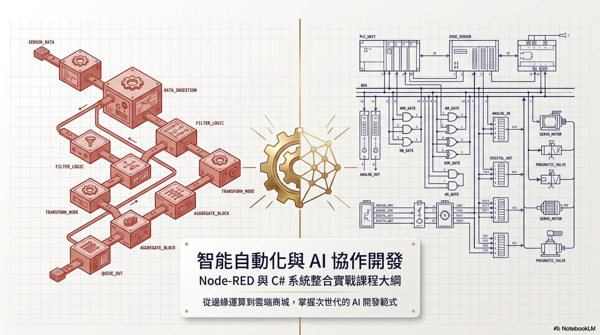
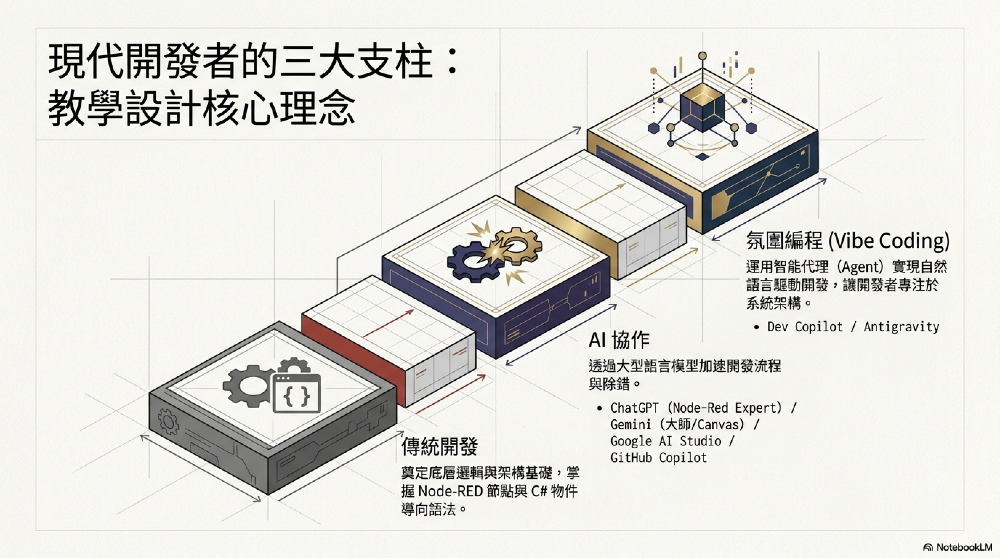
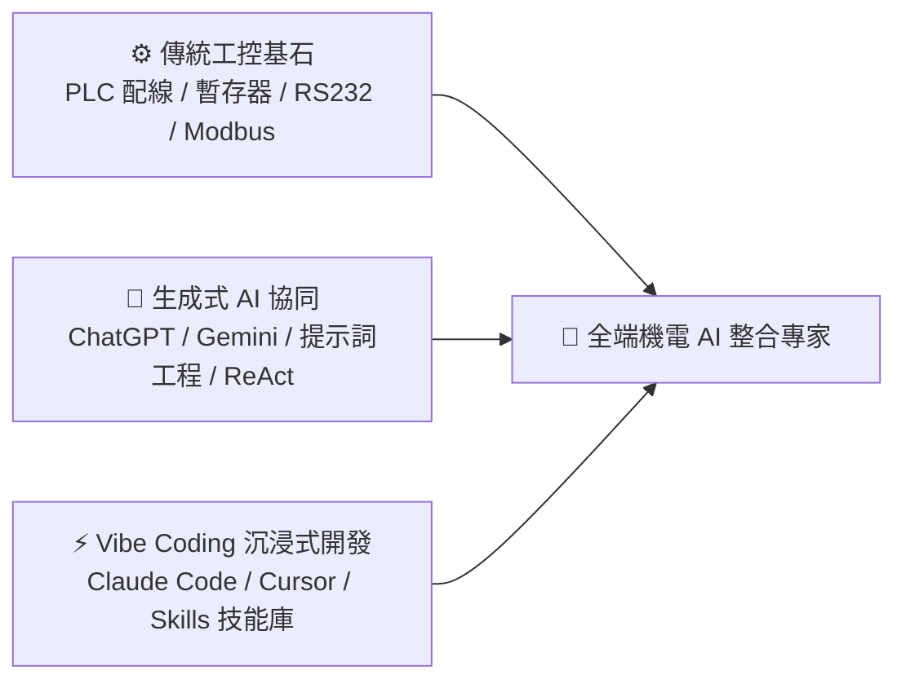
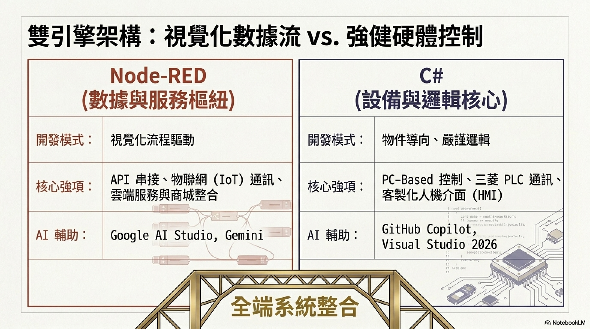
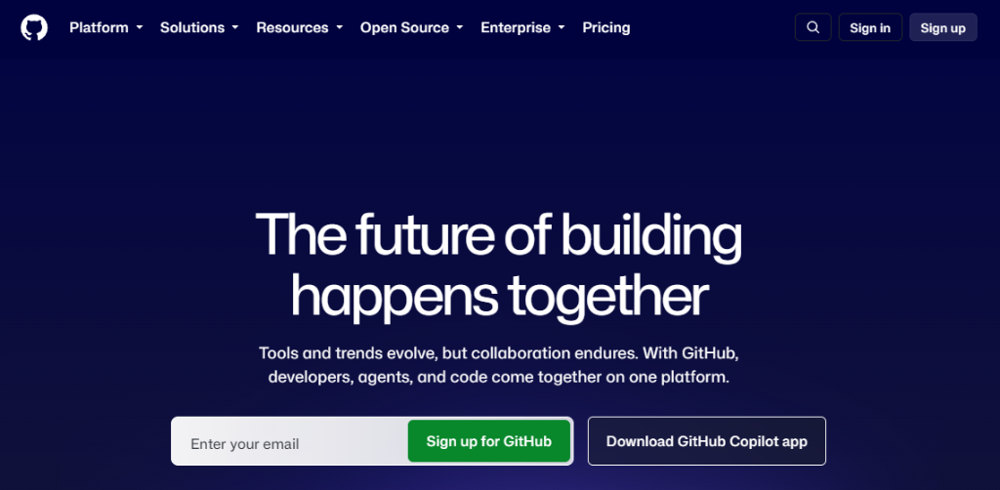

# 五股職訓局｜機電 AI 班：智慧自動化與全端工控實戰生態系
> **Node-RED 智慧中樞 × C# 工控上位機 × 生成式 AI 協作 (Vibe Coding) × 次世代工業 4.0 整合課程講義**

<p align="center">
  
</p>

<p align="center">
  <a href="https://echomanrido.github.io/node-red_AI_115-1/"></a>
  <a href="https://echomanrido.github.io/node-red_AI_115-1/sitemap.html"></a>
  
  
  
</p>

---

## 📌 專案簡介與線上入口

本專案為勞動力發展署五股職業訓練場**「機電 AI 班」**之官方完整教材庫與全端互動學習系統。教材緊扣現代工業 4.0 數位轉型趨勢，打破傳統工控封閉隔離的壁壘，將**硬體即時控制**、**邊緣物聯網閘道器**與**雲端／地端生成式 AI (Generative AI)** 深度串聯，帶領學員跨越「PLC 配線 ➔ 視覺化 SCADA ➔ 上位機 PC-Based ➔ AI 自主代理」的完整全端技術棧。

- 🌐 **線上教學首頁**：[https://echomanrido.github.io/node-red_AI_115-1/](https://echomanrido.github.io/node-red_AI_115-1/)
- 🗺️ **全站網站地圖與互動教學心智圖**：[https://echomanrido.github.io/node-red_AI_115-1/sitemap.html](https://echomanrido.github.io/node-red_AI_115-1/sitemap.html)
- 🧭 **Google Search Console 已索引**：整合標準 `sitemap.xml` 與 `robots.txt`

---

## 💡 核心教學設計理念：三大支柱 × 雙引擎架構

<p align="center">
  
</p>



### 1. 雙引擎架構 (Dual-Engine Architecture)
- **視覺化資料流中樞 (Node-RED)**：負責物聯網協定轉換 (MQTT/TCP)、異步 I/O 調度、Web SCADA 監控儀表板、外部 API 與雲端串接。
- **強健硬體即時控制 (C# PC-Based)**：負責高頻多執行緒運算、工業通訊底層校驗 (Checksum/CRC)、三菱 FX3U 協議實作、機械手臂 API 與關聯式資料庫交易。

<p align="center">
  
</p>

---

## 🗺️ 全站 8 大核心教學模組

```mermaid
graph TD
    Root["五股職訓局 機電AI班<br/>智慧機電 × AI 整合學習生態系"]
    
    Root --> M1["模組 1: Node-RED 智慧控制"]
    Root --> M2["模組 2: C# 工業控制模組"]
    Root --> M3["模組 3: 8 大次世代實務專題"]
    Root --> M4["模組 4: Vibe Coding 協作專區"]
    Root --> M5["模組 5: 生成式 AI 工具箱"]
    Root --> M6["模組 6: IPAS 國家級認證"]
    Root --> M7["模組 7: 互動情境模擬器"]
    Root --> M8["模組 8: 課程大綱・其他"]

    M1 --> M1_1["33 個實作 Labs 實驗室"]
    M1 --> M1_2["21 篇深度學習補充教材"]
    M1 --> M1_3["22 大實務專題 PPT 拆解"]
    M1 --> M1_4["V8 / libuv 底層邏輯剖析"]

    M2 --> M2_1["46 單元 PC-Based 控制"]
    M2 --> M2_2["三菱 FX3U 序列通訊專題"]
    M2 --> M2_3["14 篇 C# 深度補充教材"]

    M3 --> M3_1["ESG 智慧工廠動態碳足跡"]
    M3 --> M3_2["Modbus / LINE Bot / 資料庫"]
    M3 --> M3_3["Epson 手臂 / 地端 LLM / 軸卡"]
    M3 --> M3_4["OpenCart 商城與 MES 戰情室"]

    M8 --> M8_1["Node-RED / C# 官方大綱 PDF"]
    M8 --> M8_2["GitHub 帳號申請實務指南"]
    M8 --> M8_3["電腦硬體規格需求與採購指南"]
```



---

### 模組 1：Node-RED 智慧控制模組
- 實驗單元：[labs.html](https://echomanrido.github.io/node-red_AI_115-1/labs.html)（收錄 33 個由淺入深的循序實作）
- 補充教材：[supplements.html](https://echomanrido.github.io/node-red_AI_115-1/supplements.html)（收錄 21 篇架構分析與工業通訊精要）
- 實戰專題拆解：[nodered_projects.html](https://echomanrido.github.io/node-red_AI_115-1/nodered_projects.html)（22 大主題 PPT 拆解）
- 底層架構：[nodered_internals.html](https://echomanrido.github.io/node-red_AI_115-1/nodered_internals.html)（深入 V8 引擎、libuv 事件迴圈與異步執行機制）

<p align="center">
  
</p>

---

### 模組 2：C# 工業控制模組
- 課程單元：[csharp.html](https://echomanrido.github.io/node-red_AI_115-1/csharp.html)（46 個單元 Windows Forms、WPF 與工控邏輯）
- 補充教材：[csharp_supplements.html](https://echomanrido.github.io/node-red_AI_115-1/csharp_supplements.html)（VS 2026 安裝與 Google Antigravity 擴充環境配置）
- 三菱 FX3U 專題：[project_plc_fx3u.html](https://echomanrido.github.io/node-red_AI_115-1/project_plc_fx3u.html)（RS232 通訊埠、三階段自動化控制、ENQ/ACK 協議握手）

<p align="center">
  
</p>

---

### 模組 3：次世代工業 8 大實務專題
1. 🌿 **[ESG 智慧工廠 (動態碳足跡閉環)](https://echomanrido.github.io/node-red_AI_115-1/project.html)**：機電丙級第二題設備實測、AI 視覺瑕疵檢測、電力能耗動態碳排計算與閉環調度。
2. 📡 **[Modbus 通訊協定 (TCP / RTU)](https://echomanrido.github.io/node-red_AI_115-1/project_modbus.html)**：工業標準語彙、MBAP 報頭、CRC-16 檢校碼演算法與封包剖析。
3. 💬 **[LINE Bot 工業告警與監控](https://echomanrido.github.io/node-red_AI_115-1/project_linebot.html)**：Messaging API 推播、n8n 工作流自動化、Google Apps Script (GAS) 零成本雲端架設。
4. 🗄️ **[工業與雲端資料庫全解](https://echomanrido.github.io/node-red_AI_115-1/project_database.html)**：MySQL 關聯資料庫、SQL Server C# 連線、InfluxDB 時序數據庫、Firebase 實時庫。
5. 🦾 **[Epson 機械手臂整合應用](https://echomanrido.github.io/node-red_AI_115-1/project_epson_robot.html)**：SCARA LS3 手臂、SPEL+ 語法、正逆運動學解算、奇點迴避與 C# RC+ API 對接。
6. 🧠 **[地端 LLM 與企業私有知識庫](https://echomanrido.github.io/node-red_AI_115-1/project_local_llm.html)**：Ollama、AnythingLLM、LM Studio、RAG 向量檢索、私有化工業知識問答。
7. 🕹️ **[運動軸卡與 IO 卡精密控制](https://echomanrido.github.io/node-red_AI_115-1/project_motion_control.html)**：大銀微系統 PCI4P、研華 PCI-1756、MCCL 動態連結函式庫、四軸同動與線性圓弧插補。
8. 🛒 **[網路商城與資料庫大型專案 (OpenCart + MES)](https://echomanrido.github.io/node-red_AI_115-1/project_opencart.html)**：4 大主題電商訂單下單、直連 MySQL 資料庫、C# 後台 Native API、REST Admin API 串接與工廠排程戰情室。

<p align="center">
  
</p>

---

### 模組 4：Vibe Coding 協同開發專區
- 主題專區：[vibecoding.html](https://echomanrido.github.io/node-red_AI_115-1/vibecoding.html)
- 內容涵蓋：
  - **軟體工程 (AI-Native SDLC)**：規格優先驅動開發 (Spec-Driven Development)、敏捷迭代與自動化重構。
  - **Skills (技能) 與 MCP 協議**：擴充 AI Agent 能力邊界、對接地端檔案與工控周邊。
  - **工程思維與逆向工程**：透過 REA 框架逆向分析原生與前端封包、剖析通訊結構。

---

### 模組 5：生成式 AI 工業工具箱與核心認知
- AI 工具箱：[aitools.html](https://echomanrido.github.io/node-red_AI_115-1/aitools.html)（收錄 24 款熱門工業 AI 協作工具）
- 核心知識：[aiknowledge.html](https://echomanrido.github.io/node-red_AI_115-1/aiknowledge.html)（提示詞工程技巧、ReAct 自主代理架構、多模態視覺辨識）

---

### 模組 6：IPAS 國家級能力鑑定專區
- 考古題測驗系統：[https://echomanrido.github.io/ipas-ai-mid-exam/](https://echomanrido.github.io/ipas-ai-mid-exam/)（AI 應用規劃師中級題庫互動刷題）
- 考照精華筆記：[https://echomanrido.github.io/ipas-ai-note/](https://echomanrido.github.io/ipas-ai-note/)
- 淨零碳盤查專區：[ipas_netzero.html](https://echomanrido.github.io/node-red_AI_115-1/ipas_netzero.html)（經濟部產發署低碳人培官方教材）

---

### 模組 7：互動式情境模擬器
- [opencart_installation_simulator.html](https://echomanrido.github.io/node-red_AI_115-1/opencart_installation_simulator.html)：OpenCart 網路商城安裝引導模擬器
- [xampp_installation_simulator.html](https://echomanrido.github.io/node-red_AI_115-1/xampp_installation_simulator.html)：XAMPP 伺服器建置與服務啟用模擬器
- [conveyor_sorting_ladder_metaphor.html](https://echomanrido.github.io/node-red_AI_115-1/conveyor_sorting_ladder_metaphor.html)：輸送帶分選與 PLC 階梯圖互動模擬器
- [valve_ifelse_metaphor.html](https://echomanrido.github.io/node-red_AI_115-1/valve_ifelse_metaphor.html)：水流閥門與 if-else 邏輯隱喻模擬器
- [dashboard_chart_types_comparison.html](https://echomanrido.github.io/node-red_AI_115-1/dashboard_chart_types_comparison.html)：Node-RED Dashboard 圖表類型比對器

---

### 模組 8：課程大綱・小分群：其他
- 課程大綱預覽：[index.html#pdf-preview](https://echomanrido.github.io/node-red_AI_115-1/index.html#pdf-preview)（Node-RED 10 頁實戰簡報 + C# 12 頁工控實戰簡報高畫質翻頁器）
- 🐙 **[GitHub 帳號申請指南 (github_signup_guide.html)](https://echomanrido.github.io/node-red_AI_115-1/github_signup_guide.html)**：官網入口、Google 一鍵授權登入、常見 "Too many requests" 錯誤排解。
- 💻 **[電腦硬體規格需求與採購指南 (supplements.html?id=sup-01)](https://echomanrido.github.io/node-red_AI_115-1/supplements.html?id=sup-01)**：Node-RED、C# 與落地型 LLM 三大場景之 CPU、RAM、顯卡 VRAM 瓶頸與採購預算分析。

<p align="center">
  
</p>

---

## 📂 專案檔案結構導覽

```text
node-red_AI_115-1/
├── index.html                   # 全站主入口 (Hero、核心導覽儀表板、簡報預覽)
├── sitemap.html                 # 視覺化網站地圖與可縮放互動心智圖 (SVG Mindmap)
├── sitemap.xml                  # Google Search Console 標準 XML 網站地圖
├── robots.txt                   # 搜尋引擎爬蟲指引規範
├── .nojekyll                    # 停用 Jekyll，支援純靜態資源高速伺服
│
├── labs.html                    # Node-RED 33 個核心實驗課程
├── supplements.html             # Node-RED 21 篇深度學習補充教材
├── nodered_projects.html        # Node-RED 22 大實務專題拆解
├── nodered_internals.html       # Node-RED 底層架構與運作邏輯
│
├── csharp.html                  # C# 工業控制 46 單元核心課程
├── csharp_supplements.html      # C# 學習補充教材 (2篇)
├── project_plc_fx3u.html        # C# 串接三菱 FX3U PLC 專題
│
├── project.html                 # ESG 智慧工廠動態碳足跡期末專題
├── project_modbus.html          # Modbus TCP/RTU 工業協定專題
├── project_linebot.html         # LINE Bot 警報推播專題
├── project_database.html        # 多資料庫整合應用專題
├── project_epson_robot.html     # Epson SCARA 機械手臂整合專題
├── project_local_llm.html       # 地端 LLM 與企業私有知識庫專題
├── project_motion_control.html  # MCCL 運動控制軸卡專題
├── project_opencart.html        # OpenCart 網路商城與 MES 資料庫大型專題
│
├── github_signup_guide.html     # 課程大綱其他：GitHub 帳號申請指南
├── vibecoding.html              # Vibe Coding AI 協同開發專區
├── aitools.html                 # 24 款工業 AI 工具教學
├── aiknowledge.html             # AI 核心知識與提示詞工程
├── ipas_netzero.html            # IPAS 淨零碳盤查官方教材
│
├── styles.css                   # 全站深色科技主題統一樣式表
├── images_src/                  # 教學截圖、高解析度簡報圖與情境圖檔
└── *.json / *Data.js            # 各模組解耦之資料庫與前端邏輯控制腳本
```

---

## ⚡ 本機開發與快速啟動 (Quick Start)

### 1. 取得專案原始碼
```bash
git clone https://github.com/echomanrido/node-red_AI_115-1.git
cd node-red_AI_115-1
```

### 2. 本機運行預覽
本專案採用現代無依賴之純前端靜態架構（HTML5 / Vanilla JavaScript / CSS3 / SVG），無需複雜建置打包步驟：
- **方法 A（推薦 VS Code Live Server）**：在 VS Code 中安裝擴充套件 `Live Server`，右鍵點擊 `index.html` 選擇 **Open with Live Server**。
- **方法 B（Python 輕量伺服器）**：
  ```bash
  python -m http.server 8080
  # 接著打開瀏覽器造訪 http://localhost:8080
  ```
- **方法 C（直接瀏覽）**：直接雙擊 `index.html` 亦可於瀏覽器本機預覽。

---

## 👨‍🏫 版權與教學資訊

- **指導老師**：Rido 老師
- **開班機構**：勞動部勞動力發展署 北基宜花金馬分署 五股職業訓練場
- **班別名稱**：機電 AI 班（115-1期）
- **授權條款**：[MIT License](LICENSE)・本講義開放供學員課後溫習、工業自動化愛好者交流與教學延伸使用。

<p align="center">
  <sub>五股職訓局 機電AI班 ｜ 智慧製造 × 邊緣運算 × 生成式 AI 最佳實踐教學系統</sub>
</p>
