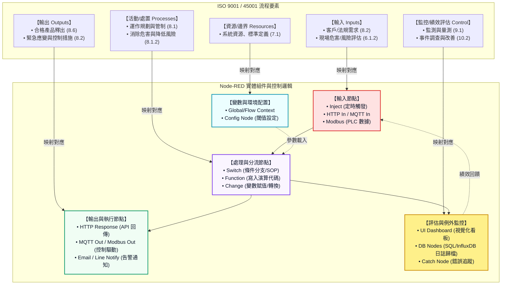

# ISO 流程對應 Node-RED 概念：智慧製造之虛實整合實踐指南

本補充教材旨在幫助「機電AI」課程的同學，理解工業界常用的國際標準流程規範（**ISO 9001 品質管理**與**ISO 45001 職業安全衛生**）如何以 1:1 的邏輯，完美對應並實現在 Node-RED 自動化控制流程中，進而實踐智慧製造的虛實整合系統 (CPS)。

---

## 🎯 核心概念：過程方法 (Process Approach)

ISO 品質與安全管理系統的核心在於**「過程方法」**：任何作業都是將指定的 **「輸入 (Inputs)」**，透過一連串的 **「活動與處置 (Processes/Activities)」**，轉換為預期的 **「輸出 (Outputs)」**，並依循 **PDCA (規劃-實施-檢查-改善)** 循環進行持續改進。

在 Node-RED 的資料流 (Data Flow) 架構中，這一邏輯能完美對應：

```
┌──────────────────┐       ┌───────────────────────────┐       ┌──────────────────┐
│   輸入 (Inputs)  │ ───>  │ 過程活動/處置 (Processes) │ ───>  │  輸出 (Outputs)  │
│  (Data/Triggers) │       │   (Logic & Rules/SOP)     │       │ (Results/Actions)│
└──────────────────┘       └───────────────────────────┘       └──────────────────┘
```

## 🗺️ 資訊圖表與對照流程圖

為了方便同學直觀學習，本教材附帶了以下兩張核心架構對照圖：

### 1. ISO 過程方法與 Node-RED 核心節點映射對照


### 2. ISO 品質與安全管制流程實務對照圖


---

## 💻 流程代碼架構 (Mermaid)

以下是將 ISO 品質/安全管制流程對應至 Node-RED 實體節點的核心架構 Mermaid 邏輯：



---

## 📊 ISO 9001 (品質) 與 ISO 45001 (安全) 運作管制比較

兩大系統在**條款 8.1（運作規劃與管制）**的日常控制中均屬於 **Do (實施)** 階段，但其實務著重點與保護對象有顯著差異：

| 比較項目 | ISO 9001 條款 8.1（品質管理） | ISO 45001 條款 8.1（職業安全衛生） |
| :--- | :--- | :--- |
| **核心保護對象** | 產品、服務與**客戶滿意度**。 | 現場作業的**人員生命安全與健康**。 |
| **日常控制焦點** | 產品規格符合性、良率、製程公差。 | 消除危險因子、控制剩餘風險。 |
| **核心控制手段** | 品質檢驗規範 (SIP)、製程管制計畫 (CP)。 | 消除 ➔ 替代 ➔ 工程控制 ➔ 管理控制 ➔ PPE。 |
| **變更管理 (MOC)** | 變更是否影響產品品質、交期與成本。 | 變更（如新設備、新流程）是否帶來新危害。 |
| **外包/採購管制** | 供應商交付之原物料或外包質量控制。 | 承攬商/外包商在廠內作業的安全與合規。 |

---

## 🏭 雙軌整合案例：智慧生產線「品質與安全」聯鎖控制

在智慧工廠的實務中，同一個 SMT 生產線或化學品操作點，通常需在 Node-RED 內同時整合這兩套標準的運作邏輯：

```
                                  ┌──> [ 9001 品質管制 ] ──> 判定錫膏厚度 ──> 良品 ──> 寫入 MES 品質履歷
[ 現場感測器 / 溫濕度 / PLC 數據 ] ┤
                                  └──> [ 45001 安全管制 ] ──> 判定有害氣體 ──> 超標 ──> 觸發自動排風與 LINE 通報
```

### 1. ISO 9001 實務範例 (以「SMT 電路板組裝」為例)
* **輸入 (Inputs)**：客製化 BOM 表、迴焊爐各溫區的標準溫度曲線設定值。
* **過程處理 (Process)**：監控迴焊爐實際溫度、執行 AOI 光學自動檢測，判定錫膏良率與位移量是否在公差內。
* **輸出 (Outputs)**：產出合格的 PCBA板、品質檢驗紀錄、不合格品自動挑退控制信號。

### 2. ISO 45001 實務範例 (以「化學品槽車卸料」為例)
* **輸入 (Inputs)**：SDS 安全技術說明書閾值、作業環境揮發性氣體濃度。
* **過程處理 (Process)**：啟動前檢查「作業許可證 (PTW)」簽核狀態、強制檢驗靜電接地信號，依據控制階層進行聯鎖判定。
* **輸出 (Outputs)**：若氣體超標則自動關閉化學閥（工程控制）、發送 LINE 告警通報應變小組（管理控制）。

---

## 🛠️ 實戰演練：快速匯入與部署

本教材提供兩套可直接部署於 Node-RED 編輯器中的範例流程，同學可透過以下步驟快速測試：

> [!TIP]
> **快速匯入三步驟**：
> 1. **複製 JSON**：點擊下方程式碼區塊右上角的複製圖示。
> 2. **匯入節點**：開啟 Node-RED ➔ 點選右上角選單 `☰` ➔ 選擇 `Import` (匯入) ➔ 貼上 JSON 代碼。
> 3. **部署執行**：點擊右上角紅色的 `Deploy` (部署) 按鈕。

### 1. ISO 9001 範例：SMT 設備溫度品質檢驗流程
模擬當設備溫度超出 ISO 管制標準（80°C）時，系統能自動進行異常判定分流，並將結果輸出。

```json
[
    {
        "id": "iso_input_inject",
        "type": "inject",
        "z": "iso_flow_demo",
        "name": "輸入：感測器溫度 (85°C)",
        "props": [
            {
                "p": "payload"
            }
        ],
        "repeat": "",
        "crontab": "",
        "once": false,
        "onceDelay": 0.1,
        "topic": "",
        "payload": "{\"sensor_id\":\"TEMP-01\",\"temperature\":85,\"location\":\"Line-A\"}",
        "payloadType": "json",
        "x": 190,
        "y": 180,
        "wires": [
            [
                "iso_process_check"
            ]
        ]
    },
    {
        "id": "iso_process_check",
        "type": "switch",
        "z": "iso_flow_demo",
        "name": "處理：檢驗溫度點 (門檻 80°C)",
        "property": "payload.temperature",
        "propertyType": "msg",
        "rules": [
            {
                "t": "gt",
                "v": "80",
                "vt": "num"
            },
            {
                "t": "lte",
                "v": "80",
                "vt": "num"
            }
        ],
        "checkall": "true",
        "repair": false,
        "outputs": 2,
        "x": 470,
        "y": 180,
        "wires": [
            [
                "iso_process_alarm_format"
            ],
            [
                "iso_output_normal_log"
            ]
        ]
    },
    {
        "id": "iso_process_alarm_format",
        "type": "change",
        "z": "iso_flow_demo",
        "name": "處理：生成品管告警紀錄",
        "rules": [
            {
                "t": "set",
                "p": "payload.status",
                "pt": "msg",
                "to": "ALARM",
                "tot": "str"
            },
            {
                "t": "set",
                "p": "payload.message",
                "pt": "msg",
                "to": "警告：設備溫度過高！已超出 ISO 品質管制標準。",
                "tot": "str"
            }
        ],
        "action": "",
        "property": "",
        "from": "",
        "to": "",
        "reg": false,
        "x": 750,
        "y": 140,
        "wires": [
            [
                "iso_output_alarm_log"
            ]
        ]
    },
    {
        "id": "iso_output_alarm_log",
        "type": "debug",
        "z": "iso_flow_demo",
        "name": "輸出：異常告警點 (記錄與通知)",
        "active": true,
        "tosidebar": true,
        "console": false,
        "tostatus": false,
        "complete": "payload",
        "targetType": "msg",
        "statusVal": "",
        "statusType": "auto",
        "x": 1030,
        "y": 140,
        "wires": []
    },
    {
        "id": "iso_output_normal_log",
        "type": "debug",
        "z": "iso_flow_demo",
        "name": "輸出：正常數據歸檔",
        "active": true,
        "tosidebar": true,
        "console": false,
        "tostatus": false,
        "complete": "payload",
        "targetType": "msg",
        "statusVal": "",
        "statusType": "auto",
        "x": 1000,
        "y": 220,
        "wires": []
    }
]
```

### 2. ISO 45001 範例：局限空間作業 (Confined Space) 安全監控流程
模擬工人在高風險局限空間作業時，當氧氣濃度低於法定安全界限（19.5%）時，自動觸發緊急安全控制與主管通報流程。

```json
[
    {
        "id": "iso45001_input_sensor",
        "type": "inject",
        "z": "iso45001_flow",
        "name": "輸入：局限空間 O2 感測器 (測得 18.0%)",
        "props": [
            {
                "p": "payload"
            }
        ],
        "repeat": "",
        "crontab": "",
        "once": false,
        "onceDelay": 0.1,
        "topic": "",
        "payload": "{\"location\":\"Confined-Space-01\",\"o2_percent\":18.0,\"worker_count\":2}",
        "payloadType": "json",
        "x": 220,
        "y": 180,
        "wires": [
            [
                "iso45001_process_eval"
            ]
        ]
    },
    {
        "id": "iso45001_process_eval",
        "type": "switch",
        "z": "iso45001_flow",
        "name": "過程：風險評估 (O2 < 19.5% 缺氧)",
        "property": "payload.o2_percent",
        "propertyType": "msg",
        "rules": [
            {
                "t": "lt",
                "v": "19.5",
                "vt": "num"
            },
            {
                "t": "gte",
                "v": "19.5",
                "vt": "num"
            }
        ],
        "checkall": "true",
        "repair": false,
        "outputs": 2,
        "x": 520,
        "y": 180,
        "wires": [
            [
                "iso45001_process_alarm_payload"
            ],
            [
                "iso45001_output_normal_db"
            ]
        ]
    },
    {
        "id": "iso45001_process_alarm_payload",
        "type": "change",
        "z": "iso45001_flow",
        "name": "過程：封裝危害控制指令",
        "rules": [
            {
                "t": "set",
                "p": "payload.status",
                "pt": "msg",
                "to": "HAZARD_ALERT",
                "tot": "str"
            },
            {
                "t": "set",
                "p": "payload.action",
                "pt": "msg",
                "to": "1. 啟動強制排風機  2. 發送安衛告警推播  3. 人員迅速撤離",
                "tot": "str"
            }
        ],
        "action": "",
        "property": "",
        "from": "",
        "to": "",
        "reg": false,
        "x": 800,
        "y": 140,
        "wires": [
            [
                "iso45001_output_alarm_notice"
            ]
        ]
    },
    {
        "id": "iso45001_output_alarm_notice",
        "type": "debug",
        "z": "iso45001_flow",
        "name": "輸出：安衛告警通報與設備控制",
        "active": true,
        "tosidebar": true,
        "console": false,
        "tostatus": false,
        "complete": "payload",
        "targetType": "msg",
        "statusVal": "",
        "statusType": "auto",
        "x": 1090,
        "y": 140,
        "wires": []
    },
    {
        "id": "iso45001_output_normal_db",
        "type": "debug",
        "z": "iso45001_flow",
        "name": "輸出：日常安衛日誌寫入 DB",
        "active": true,
        "tosidebar": true,
        "console": false,
        "tostatus": false,
        "complete": "payload",
        "targetType": "msg",
        "statusVal": "",
        "statusType": "auto",
        "x": 1070,
        "y": 220,
        "wires": []
    }
]
```

> [!NOTE]
> 部署完成後，點擊 Inject 節點左側的按鈕，即可在右側除錯面板中查看輸出結果，驗證當偵測值異常時，資料是如何經由 Switch 與 Change 節點進行判定並輸出警報。
